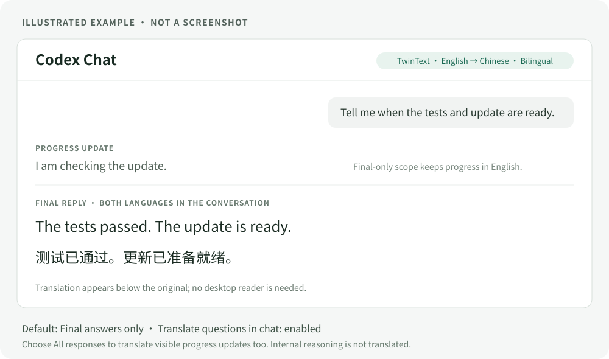
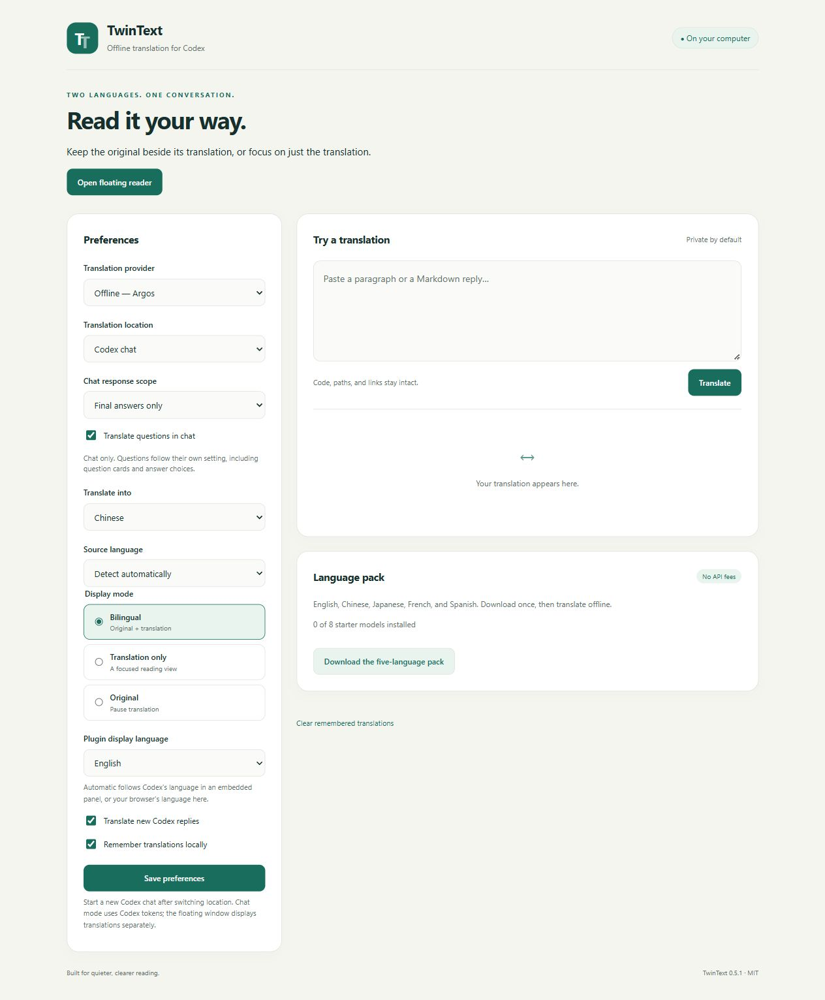
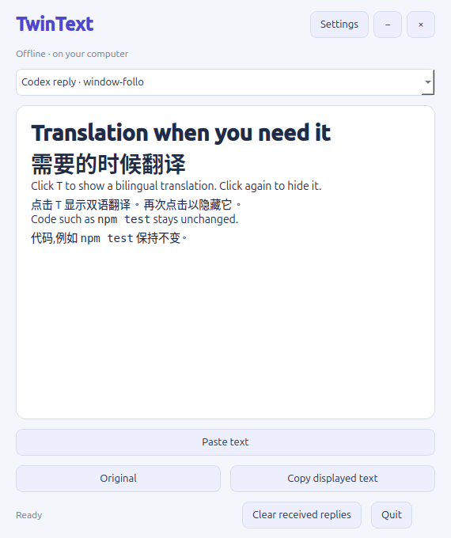
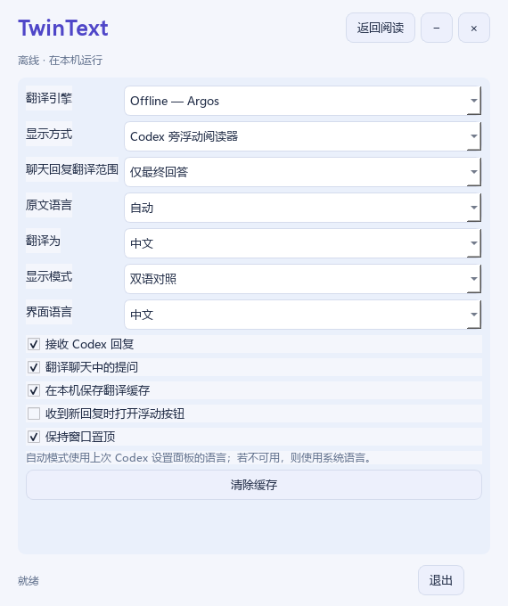
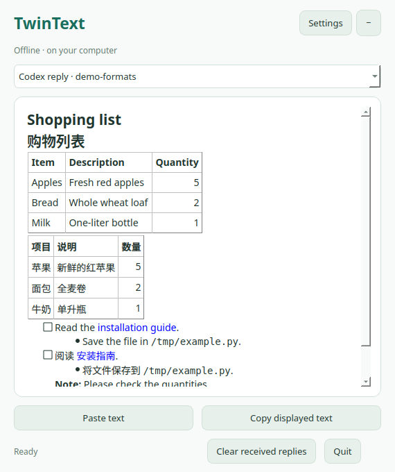
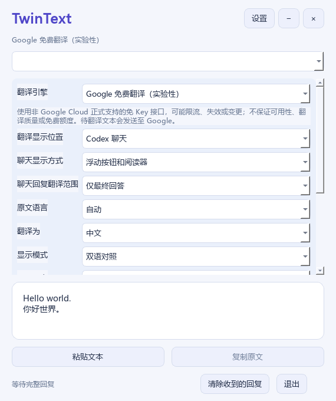

# TwinText for Codex

**Read Codex replies in two languages, or just your preferred language.** TwinText
is a free, open-source translation companion for **Windows and Linux**, powered
by Argos Translate and CTranslate2 on your computer.

Choose **English, Chinese, Japanese, French or Spanish** for translation. Set the
TwinText interface language independently, or let Automatic follow the available
host/system language. Offline (the default) runs locally after model downloads.
Microsoft Azure Translator is an optional provider using your own credentials.
Google Free (experimental) is an optional keyless online provider. Offline remains the default.

[Download 0.9.2](https://github.com/LincolnGothic/twintext-codex/releases/tag/v0.9.2) ·
[Installation](#install-or-upgrade) · [Troubleshooting](docs/troubleshooting.md) ·
[Format coverage](docs/output-formats.md)

## Two styles, one installation

| Style | What you see | Codex token use |
| --- | --- | --- |
| **Chat** | Selected replies and questions translated in the conversation, or in an optional floating Chat reader | Inline translations use normal tool/context/output tokens; floating progress/question delivery uses tool tokens without translated-context additions |
| **Desktop** | Completed replies in a separate floating window, with a compact draggable button | Automatic translation makes no additional LLM requests and returns no translations to model context |

Chat preserves the original **0.1** experience; Desktop preserves the **0.2.2**
experience. Version **0.9.2** maintains both through a shared translation engine,
Markdown parser, language packs and settings. The old releases are historical
versions; new fixes apply to both styles in the current version.

Select **Display location** in TwinText settings: **In Codex conversation**,
**Floating reader beside Codex**, or **Desktop reader (completed replies)**.
This single control replaces the separate location and Chat presentation selectors;
existing saved preferences are preserved. Start a **new Codex chat**
after switching styles so instructions from the previous style do not persist.
Desktop is the default for a repository install. A release ZIP chooses its named
style only on a first installation; upgrades preserve the existing choice.

### Codex Chat

Read the original reply and its translation **inside the Codex conversation**.
Choose **Bilingual** to show both languages, or **Translation only** to show the
translated text. The default **In conversation** presentation does not automatically
open a floating reader.



*Illustrated example, not a Codex screenshot. It shows the default Final answers
only scope; the exact host layout and offline translation wording can vary.*

After [finishing setup](#finish-setup-and-try-a-translation):

1. Open TwinText settings in the Codex plugin panel, or use `twintext ui --open`
   with the [Windows CLI launcher](#windows) on Windows.
2. Set **Display location → In Codex conversation**, **Translate into → Chinese**
   (or your preferred language), and **Display mode → Bilingual**.
3. Choose **Final answers only** or **All responses (including progress updates)**.
   Set **Translate questions in chat** separately; it is enabled by default.
4. Save your preferences and start a **new Codex chat** with TwinText enabled.
   Ask for a short English answer and check that its translation appears in the
   same conversation. Language models must be installed for Offline translation.

Chat settings also include **Chat response scope**: **Final answers only** (default)
or **All responses (including progress updates)**. **Translate questions in chat**
is enabled by default and independently controls questions in the conversation
and question cards, including answer choices. Turning it off leaves questions
untranslated even with All responses selected. Pausing translation disables both.
Tool results and hidden reasoning are never translated. These controls apply to
Chat only; Desktop continues to capture completed final replies. Existing settings
without these fields use the new defaults. Automatic translation depends on Codex
following the plugin instructions; it does not modify the native chat renderer.

CLI equivalents: `twintext settings --response-scope final --translate-questions true`
or `twintext settings --response-scope all --translate-questions false`.

<details>
<summary>See the Chat settings: response scope, question translation and bilingual display</summary>



*Screenshot of TwinText 0.5.1's web settings in an isolated preview. Current versions
combine location and presentation into Display location. The preview has no
language packs installed; install models before using Offline translation.*

</details>

#### Translate a specific old reply (experimental, Windows, 0.9.0)

An optional **Translate / Original** button appears after each recognized,
completed assistant reply in Codex, including historical replies loaded as you
scroll. Click it to translate **that reply** in the separate TwinText reader;
click again for its original. The Codex message and its native Copy action stay
unchanged. Scrolling and message discovery do not translate.

1. Choose **Display location → Floating reader beside Codex**, your existing
   provider, target language and **Bilingual** display.
2. Enable **Per-reply Translate buttons (experimental, manual only)**. This
   disables automatic Stop capture and progress/question forwarding. Automatic
   and inline Chat modes remain available when this option is off.
3. Optionally enable **Only remember translations until TwinText exits**. Both
   fragment and full reader-result caches then live only in memory. Exiting
   TwinText or shutting down releases them; settings, models and original reply
   history remain on disk.
4. Run **Open Codex with TwinText.cmd** from the TwinText installation folder in
   File Explorer and leave its terminal open. If it says **Waiting**, quit Codex
   and its shared ChatGPT app normally, including any background/tray instance.
   Startup continues automatically once the app exits; **Ctrl+C** cancels waiting.
   Closing just a chat window can leave the shared app running. No app is closed
   by TwinText. Startup details remain in `desktop/launcher.log` under TwinText's
   data folder. See [launcher troubleshooting](docs/troubleshooting.md#the-codex-launcher-stops-at-press-any-key).
5. Open an old completed reply and click **Translate**. The per-message actions
   stay **Translate / Original** in every interface language; tooltips are localized.
   The reader also keeps its own **Translate / Original** toggle and **Copy original**.

This adapter is **experimental**. It uses a runtime debugging connection and
private React message props, rather than an official Codex message-toolbar API.
The Windows `26.1013.4894.0` renderer shape was inspected statically. DOM and
protocol tests use controlled fixtures; **interactive native compatibility still
needs verification after launching Codex this way**. Unrecognized messages receive
no button, with no fallback to the latest reply or clipboard. Hidden reasoning,
tool results and question-card controls are not translated. Completed visible
assistant prose can be selected regardless of automatic final/progress scope.

The launcher opens debugging on **127.0.0.1:9223**. Other processes on this computer
may access that debugging endpoint; do not forward it to a network or add broad
remote-origin flags. TwinText rejects external/redirected endpoints, bypasses
proxies for this loopback connection, and requires exactly one supported main
window. Keep one Codex window open for this mode. Version 0.9.1 launches the shared
`ChatGPT.exe` directly when present, bypassing the `Codex.exe` activation stub, and
waits up to 20 seconds for the debugging port before reporting startup success.
If Codex rejects the launch flags
or changes its renderer, manual Paste remains available. No Codex files are patched.
Exit Codex and launch it normally to stop debugging. Provider policies still apply.
Button translation makes no LLM calls or translated-context additions.

CLI: `twintext settings --workflow chat --chat-presentation floating --message-buttons true --cache-lifetime session`,
then `twintext codex-launch --wait` on Windows (`--wait` waits for an existing app
to exit; omit it to report an error immediately). Linux keeps existing reader/automatic/inline
workflows; the experimental launcher currently supports Windows only.

#### A button that follows Codex (0.8.0)

To show translations only when you press a button:

1. In TwinText Settings, choose **Desktop reader (completed replies)**, enable
   **Follow Codex window**, and set your translation language.
2. Choose **Bilingual** or **Translation only** for the reader.
3. Enable **Open floating button on new replies** and start a new Codex chat with
   the TwinText plugin enabled and its Stop hook trusted.
4. Click **T** once to show the reader; click again to hide it. Codex's original
   answer stays visible in its conversation. Completed translations are reused.

The compact button sits inside the upper-right edge of Codex's window. Drag it
to choose a different position for this run. The button and open reader follow
window movement and resizing, hide when Codex is minimized or another app is
active, and return when Codex is active again. With several Codex windows, they
follow the most recently focused one. The reply selector still contains captured
replies across chats; following a window does not identify its selected chat.

Attachment supports **Windows** and **Linux X11/XWayland**. Linux automatically
uses Qt's XCB backend when attachment is enabled at startup and DISPLAY is
available; restart TwinText after enabling this setting in a Wayland session.
Native Wayland Codex windows cannot be tracked through this interface. If no
compatible Codex window is found, the button remains manually movable. Following
is off by default for existing installations and can be enabled in native/web
settings or with `twintext settings --follow-codex true`.

This is a separate companion overlay. TwinText does not insert a native icon
beside Codex's Copy button or rewrite messages already displayed by Codex. The
[documented plugin UI](https://developers.openai.com/plugins/build/chatgpt-ui)
runs in a separate component; it does not document a native message-toolbar slot.



*Live Linux reader preview with sample text, attached to a detected Codex window.
The reader uses the same selected mode when reopened.*

CLI: `twintext settings --workflow desktop --follow-codex true --target zh --mode bilingual`.
Then run `twintext desktop --background`. Use `--mode translated` for translation
only. Desktop capture adds no translation text to Codex context. New replies
received while the attached reader is collapsed are translated on first open.

#### Floating Chat presentation: copy only the original

Prefer a small translation button beside Codex? Choose **Display location →
Floating reader beside Codex** and **Display mode → Bilingual**. Enable **Open
floating button on new replies** in native settings, or open the reader manually.
Start a new chat after switching display location.

- Drag the small **T** button beside the conversation. Click once to show the
  bilingual reader beside it; click again to hide it and leave the original
  Codex conversation visible. **×** quits both windows. The button can
  track Codex when **Follow Codex window** is enabled in settings.
- New answers stay in their original language inside Codex. Its Copy button
  therefore excludes translations. The reader's **Copy original** copies the
  exact original Markdown, even while bilingual text is visible.
- In the reader, **Original** hides the translation and cancels pending work;
  **Translate** shows it again. Completed translations are reused without another
  translation request. This temporary switch does not change saved preferences;
  new replies use the saved display mode. With **Display mode → Original**, a
  manual Translate click shows a bilingual view for that reply.
- **Settings** replaces the reader and paste area with preferences. **Back to
  reader** restores them. Smaller windows can scroll the preferences. Choosing
  **In Codex conversation** keeps settings open until Back, then closes the reader.

- Final answers arrive through Stop when question translation is enabled. With
  questions disabled, Codex forwards only informational final passages through
  the delivery tool, excluding questions even in mixed replies. With **All responses**, selected progress
  updates are forwarded to the reader; enabled questions and answer-choice
  summaries follow their independent setting. These deliveries require Codex
  to follow the plugin instructions and use its local delivery tool.
- Each newly received reply and completed translation remains in local history,
  selectable after restarting the reader or clearing the translation cache.
  History has no automatic expiry; **Clear received replies** removes it.
  Previous chat messages remain unchanged and are not automatically imported.



*Native Chinese-interface preview of 0.7.1 using isolated settings.*


*Native reader preview using real Offline translations and isolated sample history.
The original answer remains in Codex; this window displays the translation separately.*

CLI: `twintext settings --workflow chat --chat-presentation floating --mode bilingual --desktop-auto-start true`.
Use `--chat-presentation inline` to return to translations in the conversation.

### Desktop

Read completed replies in a **separate floating window**. Collapse it to the
compact draggable TwinText button, or use **×** to quit the reader. Switching to
**In Codex conversation** closes a running reader after leaving native settings;
opening it manually for settings remains available.



**Public preview:** native Windows and Linux checks passed, but interactive Codex
sessions and window movement still need wider host testing. These downloads are
source-and-installer packages requiring Python; they are not self-contained apps.
macOS is not included. Claude Code integration is not included.

## Download

Choose your operating system and preferred first-install style:

| Operating system | Chat default | Floating-window default | Checksums |
| --- | --- | --- | --- |
| Linux | [Linux Chat ZIP](https://github.com/LincolnGothic/twintext-codex/releases/download/v0.9.2/TwinText-0.9.2-linux-chat.zip) | [Linux Desktop ZIP](https://github.com/LincolnGothic/twintext-codex/releases/download/v0.9.2/TwinText-0.9.2-linux-desktop.zip) | [SHA256SUMS](https://github.com/LincolnGothic/twintext-codex/releases/download/v0.9.2/SHA256SUMS-linux.txt) |
| Windows | [Windows Chat ZIP](https://github.com/LincolnGothic/twintext-codex/releases/download/v0.9.2/TwinText-0.9.2-windows-chat.zip) | [Windows Desktop ZIP](https://github.com/LincolnGothic/twintext-codex/releases/download/v0.9.2/TwinText-0.9.2-windows-desktop.zip) | [SHA256SUMS](https://github.com/LincolnGothic/twintext-codex/releases/download/v0.9.2/SHA256SUMS-windows.txt) |

Each ZIP supports **both** styles. Install one package, then switch in settings.
Check its SHA-256 hash against the matching checksum file before installation.
Windows packages are unsigned. The release contains TwinText source and installers;
Python, dependency binaries and model weights are downloaded separately.

## Install or upgrade

Requirements: **64-bit Python 3.10–3.13** with pip and venv, internet during setup,
and several GB of free disk space. Python 3.12 is recommended; Python 3.14 is not
supported by the model dependencies. Desktop needs a graphical session.

Native CI validated **Windows x86-64 and Ubuntu Linux x86-64**, using Python 3.10,
3.12 and 3.13 for regression tests and 3.12 for full installation. Other Linux
distributions depend on their Qt libraries and window manager. ARM hosts have
not been validated.

### Linux

Extract your ZIP, open a terminal in its folder and run:

```bash
bash scripts/install-linux.sh
```

From a repository clone, the same command defaults to Desktop. Select Python
explicitly with `TWINTEXT_PYTHON=/usr/bin/python3.12` if needed. The installer
creates a private runtime and **TwinText Desktop** application-menu entry.
The CLI launcher is `~/.local/bin/twintext`.

If Qt reports missing system libraries on Ubuntu/Debian, install the needed packages:

```bash
sudo apt install libegl1 libopengl0 libxcb-cursor0 libxkbcommon-x11-0
```

### Windows

Install 64-bit Python 3.12 from [python.org](https://www.python.org/downloads/windows/)
with pip and venv. Extract your ZIP, open PowerShell in its folder and run:

```powershell
powershell -NoProfile -ExecutionPolicy Bypass -File .\scripts\install-windows.ps1
```

The execution-policy option applies only to that process. The installer does not
change machine/user policy or PATH. To choose an interpreter, append
`-Python 'C:\path\to\python.exe'` to that command.

Open **TwinText Desktop** from Start, or run
`%LOCALAPPDATA%\TwinText\Open TwinText.cmd`. For CLI commands in PowerShell:

```powershell
& "$env:LOCALAPPDATA\TwinText\TwinText.cmd" ui --open
& "$env:LOCALAPPDATA\TwinText\TwinText.cmd" settings --workflow chat --target zh
```

### Finish setup and try a translation

1. **Download a language pack.** Models are not downloaded by default. Open web
   settings with `twintext ui --open` on Linux, or the Windows command above, and
   request the five-language pack. Existing models are preserved on upgrade.
   Review [model notices](THIRD_PARTY_NOTICES.md) before downloading.
2. **Choose your preferences.** Set translation location, source/target language,
   display mode and interface language. The default target is English; choose
   another target to translate an English reply. For an initial test, choose
   source **English**, target **Chinese** and display **Bilingual**.
3. **Test locally.** Paste an English sentence or Markdown table into TwinText and
   press **Translate**. This checks the engine independently of Codex capture.
4. **Enable Codex integration.** Install/update **TwinText** from your personal
   Codex marketplace, restart Codex and review/trust its hooks. The plugin name
   is `twintext`; a new personal marketplace is `twintext-linux` or `twintext-windows`.
   Existing marketplace names and unrelated entries are preserved. Installation
   does not automatically grant hook trust.
5. **Start a new Codex chat.** Chat uses SessionStart/UserPromptSubmit to instruct
   Codex to call the translator. Desktop uses Stop to capture the completed reply.
   Ask for a short English reply or table and verify your chosen display style.

To download models during installation, use `--download-models` on Linux or
`-DownloadModels` on Windows. You can also install one pair with
`twintext models install --source en --target zh`, or all eight starter models
with `twintext models install --starter`. Use the Windows CLI launcher for the
same commands on Windows.

Upgrades preserve settings and installed models unless you explicitly select a
new workflow. The compatibility adapter replaces the old portable root manifest
so the tested Codex loader discovers its hooks; added hooks may require review.
The integration uses GitHub/manual installation rather than an OpenAI public
plugin-directory listing.

## Languages, formats and controls

All five languages are available for translation and the TwinText interface.
Eight starter models connect each supported language to English; other language
pairs pivot through English. Offline quality varies, especially for short or
mixed-language text. Select the source explicitly when automatic detection is uncertain.

**Translation language** and **interface language** are separate settings.
Automatic interface language uses the last supported Codex locale supplied by the
embedded settings panel, falling back to the system language in Desktop. A browser
settings page follows its available host/browser locale. Hooks do not supply Codex's
UI locale, so Automatic cannot always match it; select a language manually if needed.

The shared parser translates table headers/cells, headings, nested lists, task
labels, visible link labels, quotes and supported footnotes. It protects code,
paths, numbers, link destinations and math. Bilingual tables appear as two complete
tables, original followed by translation; translation-only displays one translated
table. See [format coverage and limits](docs/output-formats.md).


- **Collapse** shows a compact TwinText button. Drag its six-dot grip or deliberately
  drag the button to move it; click the button to expand. A dot indicates a new reply.
  **×** on the compact button or reader quits the reader; **−** collapses it.
  Closing either window also quits. Auto-start preferences are preserved.
- Switching to **Codex chat → In conversation** closes an already-running reader, including
  changes made from the web/embedded settings panel. Inline Chat never launches the
  floating button automatically; explicitly opening manual preview/settings is available.
- Scrolling over native dropdowns scrolls the preferences panel without changing
  selections. Use clicks or keyboard keys to change an option.
- Drag the reader header to move it; use its bottom-right grip to resize. Settings
  scroll in smaller windows. **Keep above other windows** requests always-on-top behavior.
- The selector retains the latest reply from up to **24 chats**. Desktop receives
  completed replies rather than partial streams and does not import previous turns.
- **Paste text** reads the clipboard only when clicked. Edit the pasted text and press
  **Translate**. **Copy displayed text** copies Markdown, including table structure.
- **Receive Codex replies** controls automatic integration. Disable **Open floating
  button on new replies** if you prefer to launch Desktop yourself. Quit stops the
  window; disable auto-start as well if you want it to remain closed.

Window placement/pinning depends on the desktop. On GNOME/Wayland, hints may be
ignored; where XWayland is available, try `QT_QPA_PLATFORM=xcb twintext desktop`.
Enable **Follow Codex window** for attachment on Windows or X11/XWayland.
Native Wayland windows require manual placement.

## Costs and privacy

TwinText has **no purchase price or subscription**. Offline translation requires
no API key or translation API fee. Azure has separate Microsoft quotas/pricing.
Argos/CTranslate2 inference runs on your CPU after models are installed. Setup and
model downloads use internet access and disk space; reading translations uses local
CPU/RAM. Ordinary Codex access and usage remain subject to your existing plan.

Inline Chat translation adds normal tool/context/output token usage. Its overhead grows
with reply length and can be substantial for long bilingual replies; it is not
claimed negligible. Desktop's automatic capture and translation make no additional
LLM requests or translated-context additions. Asking Codex to open, configure or
manually translate with TwinText still uses normal Codex tokens in either style.
Floating Chat also keeps reader translations outside model context. Final capture
uses Stop without a translation tool call when question translation is enabled.
With questions disabled, selected final passages use the delivery tool instead.
Final, progress and question deliveries use normal Codex tool tokens when selected.

TwinText has no telemetry, background clipboard monitoring, OCR or automatic provider
fallback. Azure sends source text to Microsoft Azure Translator; screenshots are
never sent to Azure. Desktop and floating Chat keep original replies on disk locally.
Floating Chat also retains completed translations in its local history. In inline Chat mode,
original/translated text enters the Codex conversation; offline inference does not
make the Codex chat itself offline. Rendered Markdown images are not fetched and
links are not opened automatically. Codex menus, screenshots, PDFs and videos are
outside this release's translation scope.

### Azure configuration and credentials

1. Create your own Microsoft Azure Translator resource and obtain its resource key
   and region. No developer-owned shared API key is bundled.
2. Run `twintext azure-configure` in your local terminal, or use **Configure Azure
   credentials** in the floating reader's settings. The local prompt masks the key.
   Never paste a key into Codex, MCP tool arguments or the web settings page.
3. Explicitly select **Microsoft Azure Translator** in settings, or run
   `twintext settings --provider azure`. Existing installations remain Offline.
   `twintext settings --provider offline` returns to local translation.

Azure uses the [Translator REST v3 API](https://learn.microsoft.com/en-us/azure/ai-services/translator/text-translation/reference/v3/translate)
directly, with the fixed global HTTPS endpoint and optional resource region.
Custom/VNet endpoints and Entra ID authentication are not supported. Azure usage
is subject to Microsoft's [current quotas](https://learn.microsoft.com/en-us/azure/ai-services/translator/service-limits)
and [pricing](https://azure.microsoft.com/en-us/pricing/details/cognitive-services/translator/).
Azure is **not guaranteed permanently free**. Azure errors never trigger fallback.

Windows stores credentials in the current user's **Windows Credential Manager**,
under a TwinText/Azure entry specific to the configuration directory. Linux uses
`~/.config/twintext/private/azure-credentials.json`, directory mode `700`, file
mode `600` (or `TWINTEXT_HOME/private`). Files must belong to the current user;
links and permissive modes are refused. This portable backend avoids a dependency
on desktop keyring services; Linux files are **not encrypted at rest**. Protect
the account, disk and backups. Credentials never enter `settings.json`, caches or
status; the Codex/MCP/web UI receives only configured/not configured status.

`twintext status`, native Azure settings and the web Azure card display
`This month: 127 requests · 143,820 characters`. Local `cloud-usage.json` stores
only the calendar month, submitted cloud request count and source character count.
Failed submissions count; cache hits/local translation do not. Long fragments are
split into bounded requests. Counters count Unicode code points and roll over
with the local month; they are estimates, not billing records. No counter or
telemetry is sent anywhere. Optional translation caching still stores translation
text locally, separately from this metadata-only counter.

### Google Free (experimental)

Choose **Translation provider → Google Free (experimental)** in native or web settings.
Save preferences in the web panel before translating. No API key or language-model
download is needed for this provider. CLI: `twintext settings --provider google-free`.
The engine is optional: it never replaces Offline by default or acts as a fallback.



*Isolated native settings preview; the public sample uses the connectivity-test translation.*

> 使用非 Google Cloud 正式支持的免 Key 接口，可能限流、失效或变更；不保证可用性、翻译质量或免费额度。待翻译文本会发送至 Google。

This keyless interface is not officially supported by Google Cloud. It may be rate
limited, fail or change; availability, translation quality and free quota are not
guaranteed. Text to translate is sent to Google. It is not the Google Cloud
Translation API, and no unlimited service or daily allowance is promised.

Requests use the fixed HTTPS endpoint `translate.googleapis.com/translate_a/single`
from the Python backend, without a public proxy or browser CORS workaround. Existing
system proxy settings still apply. Google automatic detection uses `sl=auto`;
`zh` maps to `zh-CN` (Simplified), and `zh-TW` selects Traditional Chinese. The
existing five interface languages and eight Offline starter models are unchanged.
Traditional Chinese is Google-only; select `zh` first before switching to Offline
or Azure. For a Traditional target: `twintext settings --provider google-free --target zh-TW`.

Google requests share a single cross-process file lock, with a 15-second network
timeout and at most two retries for 429, temporary network errors and recoverable
5xx responses. Backoff honors valid `Retry-After` seconds or HTTP dates. Other
rejections, malformed responses and certificate failures are not repeatedly retried.
An in-flight blocking network call may finish at its timeout before cancellation
returns; cancellation stops queued requests, remaining chunks and retry waits.
Closing the native reader or leaving the standalone local preview cancels that work.
The MCP server also processes `notifications/cancelled` during translation. The
embedded panel sends cancellation on close/timeout, but Codex must forward it;
hosts that ignore it cannot guarantee cancellation. No provider fallback occurs.

Text is split at reasonable boundaries within a conservative 1,800-character
**encoded URL** budget, including the query. This is an implementation choice, not
an official Google limit. Markdown paragraphs/cells remain separate; responses are
parsed only for translation segments. Existing local cache keys include provider,
source, target and original text, with the same clearing/10,000-entry lifecycle.
Google translations do not affect the Azure-only monthly usage counter.

### Local records

| Data | Linux default | Windows default |
| --- | --- | --- |
| Preferences | `~/.config/twintext/settings.json` | `%APPDATA%\TwinText\settings.json` |
| Translation cache | `~/.local/share/twintext/translations.sqlite3` | `%LOCALAPPDATA%\TwinText\translations.sqlite3` |
| Received Desktop replies | `~/.local/share/twintext/desktop/inbox.sqlite3` | `%LOCALAPPDATA%\TwinText\desktop\inbox.sqlite3` |
| Language models | `~/.local/share/twintext/argos/packages/` | `%LOCALAPPDATA%\TwinText\argos\packages\` |

Linux honors `XDG_CONFIG_HOME` and `XDG_DATA_HOME`. `TWINTEXT_HOME` overrides
settings/data locations for isolated tests.

Default disk caching has **no timed expiry** and retains up to **10,000 fragments**
with least-recently-used eviction. Floating Chat stores completed reader results
separately with original history. Existing installations keep this policy.
**Remember translations locally** off stops both cache reads/writes, preserving
existing saved data.

**Only remember translations until TwinText exits** (`cache_lifetime: session`)
keeps fragments and full reader results together in bounded process memory (up to
10,000 entries). No new translations are saved to disk; exit or shutdown releases
them, including abnormal process exit. Existing disk translations are ignored.
**Clear cache** removes old and current translations from both stores while
preserving original history, models and settings. No shutdown script is needed.

The Desktop inbox separately retains one latest original reply per chat, up to
24 chats. Floating Chat retains original captured/manually selected replies until
**Clear received replies**, which clears history and its reader results, preserving
preferences, models and the disk fragment cache. Empty SQLite files can remain.

## Development and verification

```bash
python3.12 -m venv .venv
.venv/bin/python -m pip install -e '.[desktop,dev]'
QT_QPA_PLATFORM=offscreen .venv/bin/python -m unittest discover -s tests -v
.venv/bin/ruff check .
pnpm install --frozen-lockfile --ignore-scripts
pnpm test
.venv/bin/python scripts/build-release.py --platform linux
.venv/bin/python scripts/build-release.py --platform windows
```

On Windows, use `.venv\Scripts\python.exe` and `.venv\Scripts\ruff.exe`; set
`$env:QT_QPA_PLATFORM = 'offscreen'` before the Qt tests. The development install
above omits the optional engine; add the `engine` extra for real-model work.

Version 0.8.0 adds regression coverage for attachment, focus/minimize/restore,
on-demand translation, drag offsets and settings. The CI matrix covers Windows
and Linux with Python 3.10, 3.12 and 3.13. The release workflow also validates installation from ZIPs,
native hooks, real Offline English→Chinese tables, Qt rendering and preservation
of settings/models on upgrade. [Release notes](docs/release-0.8.0.md).
Version 0.9.0 adds owned DOM fixtures for per-message buttons, CDP target/protocol
validation, manual reader selection/cancellation, and session-cache persistence
and process-lifetime tests. Interactive Codex sessions, hook trust and compositor
behavior still require host testing. Real-model release smoke tests do not certify
native per-message UI compatibility.

Read [architecture](docs/architecture.md), [troubleshooting](docs/troubleshooting.md)
and [release notes](docs/release-0.9.0.md). Report bugs with your OS, Python/Codex/
TwinText versions, style, language pair and a sanitized Markdown example; avoid
posting private conversations or local databases.

## Remove TwinText

Disable/uninstall its Codex plugin and quit the reader. Remove only TwinText's
marketplace entry and launchers. On Linux, remove its owned `~/.local/bin/twintext`
link and application-menu entry; on Windows remove its TwinText Start shortcut
and command launchers.

To remove the runtime while keeping records/models, remove the `venv`, `source`
and `plugin` subdirectories under the data directory above. To remove all TwinText
local data, remove that whole data directory and its separate preferences directory.
Keep unrelated marketplace entries and applications intact.

## License

TwinText's own source is [MIT licensed](LICENSE). It is an independent project,
not affiliated with OpenAI or Immersive Translate. Runtime dependencies and language
models retain their own licenses; see [THIRD_PARTY_NOTICES.md](THIRD_PARTY_NOTICES.md).
Several legacy model-weight licenses remain unclear. Free pricing and separate
model downloads do not establish permission for commercial use or redistribution.
The release ZIPs contain no third-party model weights or runtime binaries.
