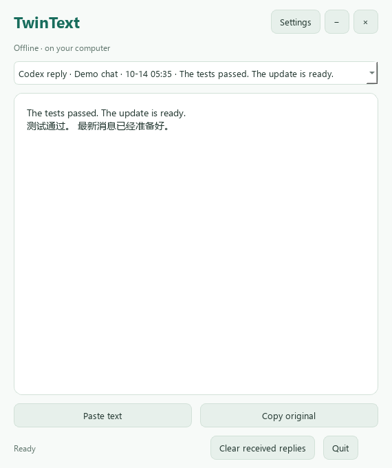
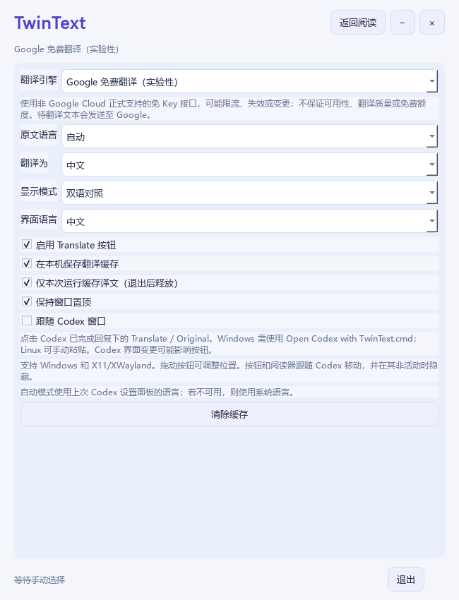

# TwinText for Codex

**Read Codex replies in two languages, or just your preferred language.** TwinText
is a free, open-source translation companion for **Windows and Linux**, powered
by Argos Translate and CTranslate2 on your computer.

Choose **English, Chinese, Japanese, French or Spanish** for translation. Set the
TwinText interface language independently, or let Automatic follow the available
host/system language. Offline (the default) runs locally after model downloads.
Microsoft Azure Translator is an optional provider using your own credentials.
Google Free (experimental) is an optional keyless online provider. Offline remains the default.

[Download 0.11.0](https://github.com/LincolnGothic/twintext-codex/releases/tag/v0.11.0) ·
[Installation](#install-or-upgrade) · [Troubleshooting](docs/troubleshooting.md) ·
[Format coverage](docs/output-formats.md)

## One method: click a reply, read separately

TwinText 0.11.0 keeps **per-reply Translate / Original → a separate reader**.
Inline-chat translation and automatic Desktop capture have been removed. Scrolling,
new replies and changing settings never start a translation. Original Codex messages
and their native Copy action stay unchanged.

- Click **Translate** below a recognized, completed assistant reply to translate
  that exact reply, including older replies loaded while scrolling.
- Click **Original** to show its source text again. The reader has the same toggle
  and **Copy original**, which copies the exact original Markdown.
- Choose **Bilingual**, **Translation only** or **Original** for the reader's view.
  These are reading preferences, not different integration methods.
- **Paste text** is the manual fallback: paste, edit, then click **Translate**.
  Per-reply buttons require the dedicated TwinText launcher on either platform.
- All providers, languages, model packages and cache controls remain available.
  Valid older profiles migrate to this method while retaining unrelated preferences.
  Saved originals are preserved, including the old Desktop inbox's retained replies.



*Reader illustration from an earlier native preview. The Codex answer stays original;
current settings no longer contain location or automatic-translation selectors.*

### Start the Windows message buttons

1. Open TwinText settings. Choose your existing provider, source/target languages,
   reader display and interface language. **Enable Translate buttons** must be on.
2. In File Explorer, run **Open Codex with TwinText.cmd** from your TwinText runtime
   folder. Leave the terminal open. If it says **Waiting**, quit Codex and its shared
   ChatGPT app normally, including any tray instance. The launcher continues after
   exit; **Ctrl+C** cancels waiting. TwinText never closes an active conversation.
3. Open a completed reply and click **Translate**. Actions remain **Translate /
   Original** in every interface language, with localized tooltips.
4. If buttons are unavailable, open the reader with **Open TwinText.cmd** and use
   **Paste text**. The legacy display-method selector has been removed, so settings
   changes no longer close the reader through a workflow switch.

This integration remains **experimental**: it uses a loopback debugging connection
and private Codex message props, not an official message-toolbar API. Unrecognized
messages receive no button; TwinText never substitutes another reply or clipboard
text. Hidden reasoning, tool results and question cards are not selected. Complete
visible assistant prose can be selected manually.

The launcher uses **127.0.0.1:9223** and starts the shared `ChatGPT.exe` when present.
Other local processes may access this debugging endpoint; do not forward it to a
network or add broad remote-origin flags. TwinText accepts only the supported local
main window and bypasses proxies for this connection. Keep one Codex window open.
No Codex application files are patched. Exit and launch Codex normally to stop debugging.
Runtime logs are in `desktop/launcher.log`; generated CMD files pin the installed
settings/data paths. See [launcher troubleshooting](docs/troubleshooting.md#the-codex-launcher-stops-at-press-any-key).

### Start the Linux message buttons

1. Keep **Enable Translate buttons** enabled in TwinText settings. The installer
   creates an application-menu entry named **Codex with TwinText**.
2. Open that entry, or run `twintext codex-launch --wait` in a terminal. If it says
   **Waiting**, leave the terminal open and quit Codex and its shared ChatGPT app
   normally. The launcher continues after exit; **Ctrl+C** cancels waiting.
3. Open a completed assistant reply and click **Translate / Original**. Keep the
   separate reader running. Scrolling, new messages and settings never translate.

To keep the reader where you place it, turn off **Follow Codex window** in settings.
This preference is independent of the message buttons and survives upgrades.

Linux discovers the native desktop executable beside `resources/app.asar`, including
the shared `/usr/lib/chatgpt/ChatGPT` package. The unrelated `codex` command-line tool
is never launched. For another native installation set `TWINTEXT_CODEX_EXECUTABLE`
to its actual `ChatGPT`/`Codex` executable. AppImage, Snap and Flatpak packages have
not been validated. The launcher checks this user's GUI processes, waits for normal
exit, and uses only `127.0.0.1:9223`, with the same message adapter as Windows.

## Download

One package per operating system, containing the same manual reader:

| Operating system | Download | Checksums |
| --- | --- | --- |
| Windows | [Windows ZIP](https://github.com/LincolnGothic/twintext-codex/releases/download/v0.11.0/TwinText-0.11.0-windows.zip) | [SHA256SUMS](https://github.com/LincolnGothic/twintext-codex/releases/download/v0.11.0/SHA256SUMS-windows.txt) |
| Linux | [Linux ZIP](https://github.com/LincolnGothic/twintext-codex/releases/download/v0.11.0/TwinText-0.11.0-linux.zip) | [SHA256SUMS](https://github.com/LincolnGothic/twintext-codex/releases/download/v0.11.0/SHA256SUMS-linux.txt) |

Check SHA-256 against the checksum file. These are source/installer archives;
Python, dependencies and models are separate downloads. Windows packages are unsigned.
The regular GitHub release does not imply official OpenAI integration support.

## Install or upgrade

Use **64-bit Python 3.10–3.13** with pip/venv and a graphical session. Python 3.12
is recommended. CI covers Windows x86-64 and Ubuntu Linux x86-64; other architectures
and Linux distributions depend on their Qt/model dependencies.

### Windows

Extract the Windows ZIP, open PowerShell in its folder and run:

```powershell
powershell -NoProfile -ExecutionPolicy Bypass -File .\scripts\install-windows.ps1
```

The installer does not change user/machine execution policy or PATH. Use
`-Python 'D:\path\to\python.exe'` to select an interpreter. The normal default
runtime is `%LOCALAPPDATA%\TwinText`; existing D: junctions/paths are retained.
Open **Open TwinText.cmd** for the reader or **Open Codex with TwinText.cmd** for
message-button integration. CLI examples:

```powershell
& "$env:LOCALAPPDATA\TwinText\TwinText.cmd" ui --open
& "$env:LOCALAPPDATA\TwinText\TwinText.cmd" settings --target zh --mode bilingual
```

### Linux

Extract the Linux ZIP and run:

```bash
bash scripts/install-linux.sh
```

Use `TWINTEXT_PYTHON=/usr/bin/python3.12` if needed. The installer creates a private
runtime, reader and **Codex with TwinText** application-menu entries, and
`~/.local/bin/twintext`. Use the Codex launcher for message buttons, or run
`twintext desktop` for the manual **Paste text → Translate** fallback. Ubuntu/Debian may require:

```bash
sudo apt install libegl1 libopengl0 libxcb-cursor0 libxkbcommon-x11-0
```

### Finish setup and try a translation

1. Select your provider. **Offline** is the default and needs language models;
   Azure requires your credentials; **Google Free (experimental)** needs no key/model.
2. For Offline, request the language pack in settings, use `twintext models install
   --source en --target zh`, or install all eight with `twintext models install --starter`.
   Windows uses the CLI launcher above. Existing models survive upgrades.
3. Choose source **English**, target **Chinese**, and **Bilingual**, then Paste a
   public sentence into the reader and click **Translate**.
4. Install/update TwinText in your Codex personal marketplace and review its hooks.
   Installation does not grant trust. Start a new chat to replace old inline/automatic
   instructions. New hooks explain manual behavior; Stop no longer captures replies.
5. On Windows, use the dedicated launcher and click a reply's **Translate** button.

Model downloads during installation are opt-in (`--download-models` on Linux,
`-DownloadModels` on Windows). Review [model notices](THIRD_PARTY_NOTICES.md).
Upgrades migrate retired workflow choices and preserve providers, source/target/UI
languages, display, enabled state, cache policy, credentials, models and originals.
The old workflow, scope, question and automatic-start CLI/settings controls are retired.

## Languages, formats and controls

Translation and interface languages are independent. The interface supports English,
Chinese, Japanese, French and Spanish. Automatic follows the saved host/system locale;
select it explicitly if needed. Traditional Chinese is Google-only.

Markdown tables, headings, lists, quotes and visible link text are supported. Code,
paths, numbers, link destinations and math remain protected. Bilingual tables show
original and translated tables separately. See [format coverage](docs/output-formats.md).

- **−** collapses the reader to a draggable button; **×** quits it. Drag the **T**
  button deliberately, or drag the reader header. Resize from the bottom-right corner.
- **Settings** replaces the reading area; **Back to reader** restores it. Dropdown
  wheels scroll settings without changing selections. Use clicks or keyboard keys.
- The reply selector retains manually selected originals. Choosing history shows the
  original first; press **Translate** to translate it. Arriving history never replaces
  the reply you are reading. Completed cached results are reused.
- **Copy original** copies source Markdown in every display mode. Paste only reads
  the clipboard when clicked; there is no background clipboard monitoring.
- **Follow Codex window** supports Windows and X11/XWayland. Native Wayland may need
  manual placement. Follow/always-on-top preferences do not choose a translation target.

## Costs and privacy

The manual message button and reader make **no LLM calls or translated-context
additions**. Asking Codex to configure/open/explicitly translate text still uses normal
Codex tokens. Translations generated in old chats remain part of those chats; the
upgrade does not edit transcripts.

Offline inference runs locally after model installation. Azure sends source text to
Microsoft; Google Free sends source text to Google. Neither is a fallback. There is
no telemetry, OCR, automatic clipboard capture or automatic provider switching.
Selected originals and optional translation caches are stored locally. Rendered images
are not fetched and links are not opened automatically.

### Azure configuration and credentials

1. Create your own Microsoft Azure Translator resource and obtain its resource key
   and region. No developer-owned shared API key is bundled.
2. Run `twintext azure-configure` in your local terminal, or use **Configure Azure
   credentials** in the floating reader's settings. The local prompt masks the key.
   Never paste a key into Codex, MCP tool arguments or the web settings page.
3. Explicitly select **Microsoft Azure Translator** in settings, or run
   `twintext settings --provider azure`. Offline remains the default; upgrades preserve the selected provider.
   `twintext settings --provider offline` returns to local translation.

Azure uses the [Translator REST v3 API](https://learn.microsoft.com/en-us/azure/ai-services/translator/text-translation/reference/v3/translate)
directly, with the fixed global HTTPS endpoint and optional resource region.
Custom/VNet endpoints and Entra ID authentication are not supported. Azure usage
is subject to Microsoft's [current quotas](https://learn.microsoft.com/en-us/azure/ai-services/translator/service-limits)
and [pricing](https://azure.microsoft.com/en-us/pricing/details/cognitive-services/translator/).
Azure is **not guaranteed permanently free**. Azure errors never trigger fallback.

Windows stores credentials in the current user's **Windows Credential Manager**,
under a TwinText/Azure entry specific to the configuration directory. Linux uses
`~/.config/twintext/private/azure-credentials.json`, directory mode `700`, file
mode `600` (or `TWINTEXT_HOME/private`). Files must belong to the current user;
links and permissive modes are refused. This portable backend avoids a dependency
on desktop keyring services; Linux files are **not encrypted at rest**. Protect
the account, disk and backups. Credentials never enter `settings.json`, caches or
status; the Codex/MCP/web UI receives only configured/not configured status.

`twintext status`, native Azure settings and the web Azure card display
`This month: 127 requests · 143,820 characters`. Local `cloud-usage.json` stores
only the calendar month, submitted cloud request count and source character count.
Failed submissions count; cache hits/local translation do not. Long fragments are
split into bounded requests. Counters count Unicode code points and roll over
with the local month; they are estimates, not billing records. No counter or
telemetry is sent anywhere. Optional translation caching still stores translation
text locally, separately from this metadata-only counter.

### Google Free (experimental)

Choose **Translation provider → Google Free (experimental)** in native or web settings.
Save preferences in the web panel before translating. No API key or language-model
download is needed for this provider. CLI: `twintext settings --provider google-free`.
The engine is optional: it never replaces Offline by default or acts as a fallback.



*Isolated native settings preview; no private conversation or provider request is used.*

> 使用非 Google Cloud 正式支持的免 Key 接口，可能限流、失效或变更；不保证可用性、翻译质量或免费额度。待翻译文本会发送至 Google。

This keyless interface is not officially supported by Google Cloud. It may be rate
limited, fail or change; availability, translation quality and free quota are not
guaranteed. Text to translate is sent to Google. It is not the Google Cloud
Translation API, and no unlimited service or daily allowance is promised.

Requests use the fixed HTTPS endpoint `translate.googleapis.com/translate_a/single`
from the Python backend, without a public proxy or browser CORS workaround. Existing
system proxy settings still apply. Google automatic detection uses `sl=auto`;
`zh` maps to `zh-CN` (Simplified), and `zh-TW` selects Traditional Chinese. The
existing five interface languages and eight Offline starter models are unchanged.
Traditional Chinese is Google-only; select `zh` first before switching to Offline
or Azure. For a Traditional target: `twintext settings --provider google-free --target zh-TW`.

Google requests share a single cross-process file lock, with a 15-second network
timeout and at most two retries for 429, temporary network errors and recoverable
5xx responses. Backoff honors valid `Retry-After` seconds or HTTP dates. Other
rejections, malformed responses and certificate failures are not repeatedly retried.
An in-flight blocking network call may finish at its timeout before cancellation
returns; cancellation stops queued requests, remaining chunks and retry waits.
Closing the native reader or leaving the standalone local preview cancels that work.
The MCP server also processes `notifications/cancelled` during translation. The
embedded panel sends cancellation on close/timeout, but Codex must forward it;
hosts that ignore it cannot guarantee cancellation. No provider fallback occurs.

Text is split at reasonable boundaries within a conservative 1,800-character
**encoded URL** budget, including the query. This is an implementation choice, not
an official Google limit. Markdown paragraphs/cells remain separate; responses are
parsed only for translation segments. Existing local cache keys include provider,
source, target and original text, with the same clearing/10,000-entry lifecycle.
Google translations do not affect the Azure-only monthly usage counter.

### Local records

| Data | Linux default | Windows default |
| --- | --- | --- |
| Preferences | `~/.config/twintext/settings.json` | `%APPDATA%\TwinText\settings.json` |
| Translation cache | `~/.local/share/twintext/translations.sqlite3` | `%LOCALAPPDATA%\TwinText\translations.sqlite3` |
| Selected original replies | `~/.local/share/twintext/desktop/inbox.sqlite3` | `%LOCALAPPDATA%\TwinText\desktop\inbox.sqlite3` |
| Language models | `~/.local/share/twintext/argos/packages/` | `%LOCALAPPDATA%\TwinText\argos\packages\` |

Linux honors `XDG_CONFIG_HOME` and `XDG_DATA_HOME`. `TWINTEXT_HOME` overrides
settings/data locations for isolated tests.

Default disk caching has **no timed expiry** and retains up to **10,000 fragments**
with least-recently-used eviction. The reader stores completed results
separately with original history. Existing installations keep this policy.
**Remember translations locally** off stops both cache reads/writes, preserving
existing saved data.

**Only remember translations until TwinText exits** (`cache_lifetime: session`)
keeps fragments and full reader results together in bounded process memory (up to
10,000 entries). No new translations are saved to disk; exit or shutdown releases
them, including abnormal process exit. Existing disk translations are ignored.
**Clear cache** removes old and current translations from both stores while
preserving original history, models and settings. No shutdown script is needed.

Selected originals remain until **Clear received replies** is clicked. Retained originals
from older Desktop profiles are imported idempotently into this history, preserving
text and timestamps. Original history is separate from the translation cache.

## Development and verification

```bash
python3.12 -m venv .venv
.venv/bin/python -m pip install -e '.[desktop,dev]'
QT_QPA_PLATFORM=offscreen .venv/bin/python -m unittest discover -s tests -v
.venv/bin/ruff check .
pnpm install --frozen-lockfile --ignore-scripts
pnpm test
.venv/bin/python scripts/build-release.py --platform linux
.venv/bin/python scripts/build-release.py --platform windows
```

On Windows, use `.venv\Scripts\python.exe` and `.venv\Scripts\ruff.exe`; set
`$env:QT_QPA_PLATFORM = 'offscreen'` before the Qt tests. The development install
above omits the optional engine; add the `engine` extra for real-model work.

The CI matrix covers Windows/Linux Python 3.10, 3.12 and 3.13. Release checks install
from each ZIP, exercise manual hooks, real Offline English→Chinese tables, Qt rendering
and upgrade preservation. Owned DOM/protocol fixtures cover exact historical message
selection, cancellation, mutation/recycling and original-text preservation. These tests
do not certify every native Codex version or compositor behavior.

Read [architecture](docs/architecture.md), [troubleshooting](docs/troubleshooting.md)
and [release notes](docs/release-0.11.0.md). Report OS/Python/Codex/TwinText versions,
language pair, and a sanitized example; do not post private chats or databases.

## Remove TwinText

Disable/uninstall its Codex plugin and quit the reader. Remove only TwinText's
marketplace entry and launchers. On Linux, remove its owned `~/.local/bin/twintext`
link and application-menu entry; on Windows remove its TwinText Start shortcut
and command launchers.

To remove the runtime while keeping records/models, remove the `venv`, `source`
and `plugin` subdirectories under the data directory above. To remove all TwinText
local data, remove that whole data directory and its separate preferences directory.
Keep unrelated marketplace entries and applications intact.

## License

TwinText's own source is [MIT licensed](LICENSE). It is an independent project,
not affiliated with OpenAI or Immersive Translate. Runtime dependencies and language
models retain their own licenses; see [THIRD_PARTY_NOTICES.md](THIRD_PARTY_NOTICES.md).
Several legacy model-weight licenses remain unclear. Free pricing and separate
model downloads do not establish permission for commercial use or redistribution.
The release ZIPs contain no third-party model weights or runtime binaries.
